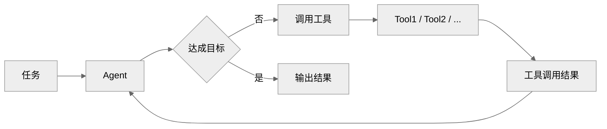
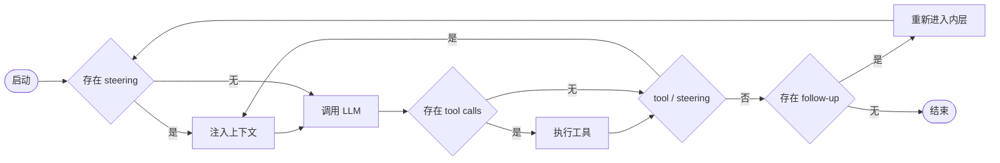

# 基于PI实现轻量级文档检索Agent
在先前我们讨论了基于向量检索实现基础`RAG`服务，在模型以及工程应用不断发展的情况下，文档检索模式也在演进，那么在这里就讨论一下如何基于`PI`实现轻量级文档检索`Agent`。

<strong>LLM Engineering 系列相关文章</strong>

- [基于 fetch 的 SSE 方案](./基于fetch的SSE方案.md)
- [基于向量检索实现基础 RAG 服务](./基于向量检索实现基础RAG服务.md)
- [流式 Markdown 增量富文本解析算法](./流式Markdown增量富文本解析算法.md)
- [基于 NodeJs 实现任务队列与优雅停机](./基于NodeJs实现任务队列与优雅停机.md)
- [仿照豆包实现 Prompt 变量模板输入框](./仿照豆包实现Prompt变量模板输入框.md)
- [基于 MdIt 的无序列表折叠插件](./基于MdIt的无序列表折叠插件.md)
- [基于 PI 实现轻量级文档检索 Agent](./基于PI实现轻量级文档检索Agent.md)

# 概述
截止目前，`AI`商业化过程中，`Coding`领域是比较流畅的商业模式，此外还有视频领域商业模式也发展的不错。而现在很多领域都是在将`AI Coding`的模式带到其他领域，例如当前正在主要发力的`AI`办公场景，在知识库场景也同样如此。

在讨论知识库的时候，首先想到的可能就是`RAG`。`RAG`最开始主要用于外挂知识库，以此扩展模型的知识范围。这个模式模式非常依赖于工程本身的建设，本质上相当于直接告诉`AI`答案，模型在这里主要起到的主要作用是`Embedding`、`Query`改写以及答案总结。

再往后发展，出现了记忆系统，即模拟短期记忆和长期记忆实现。但是在记忆系统中，同样依赖于工程本身的视线，读取和写入都是由记忆系统本身决定的，类似于工程替模型本身做了决策，而写记忆和读记忆的决策本身又是需要上下文，这存在一个循环依赖的问题。

其实，在当前的模型本身越来越强的情况下，我们可以总结检索的最佳实践为: **从“知识被动投放到模型”转变为“模型主动探索知识”**。

那么本文标题重点表达是文档检索的`Agent`实现，实际上这里的主要思路是，文档站对读者而言可能主要就是个文档集。而借助`Agent`使其自主检索用户所需的知识，类似于`DeepResearch`，那么文档站就变成了一个知识库。

因此在这里我们借助`PI`实现轻量级文档检索`Agent`，不过在当前`AI Coding`几乎接管了具体代码实现的状态下，这里主要还是简单讨论一些实现思路以及需要考虑的问题点，不再详细展开代码实现细节了。

## Loop Agent
前边提到，最开始的文档检索主要是`RAG`的模式，而得益于模型以及上下文工程的发展，通过`Loop`的方式，模型可以最终得到一个收敛的结果，而不必非得要通过预设`workflow`的方式得到目标结果。

所谓`Loop`，就是模型在执行任务的过程中，根据上下文和工具的反馈，不断调整自己的行为，直到最终得到一个收敛的结果。其实这也挺依赖于模型能力，否则也会出现无法收敛即无限循环的情况，通过这种方式实现的`Agent`，我们简称为`Loop Agent`。

接下来，可以直接借助`PI`来实现`Loop Agent`。在这里没有太大必要自己实现一套`Loop`机制，在`PI`中将核心包拆了出来，在这里主要是用的是`@earendil-works/pi-agent-core`核心包以及`@earendil-works/pi-ai`适配器。

在使用`PI`的`Loop`时，还是有必要读一下 <https://zhanghandong.github.io/pi-book/ch08-agent-loop.html> 。这里主要介绍了`PI`的两层循环，分别对应了`steer/followup`两种类型的消息任务模式。

- Steering: 转舵，用户在 agent 工作过程中插入一条新指令，比如"别改那个文件，换一种方式"。它在当前 turn 的工具执行完成后注入，影响下一次 LLM 调用。
- Follow-up: 追加，用户在 agent 完成后追加一条新任务，比如"好的，现在写测试"。它只在 agent 本来要退出时才被消费。

Tools MCP

甚至工程做的越轻越好 LLM是纯语言的，缺乏环境感知能力，所以harness的核心目标应该围绕着“增强”环境感知能力

   服务端用户粘性

没那么流畅 由于先内容后tool的先后顺序  先平铺再收起 / 任务结束总结 tool[terminate: true 主动跳出内层循环的模式]

流畅的交互模式：思考-tool-思考-tool-答案 low/medium 思考

## 二级索引
llms.txt 目录 + 标题 + summary

内容上的二级索引

skill渐进氏披露 SKILL其实也是文档，特别是在系统中存在大量SKILL的时候

## 检索模式

搜索ES配置 / 向量检索

code embedding

大力出奇迹/RG/GREP OnCall场景

## 正向反馈系统

正反馈系统    完全不需要人介入？

维护文档的作用越来越重 无论是什么角色 给AI提供上下文都可以作为文档看待

额外的话题，云端 Agent -> 本地 Agent -> 本地 Agent和云端 Agent 结合

## 每日一题

- <https://github.com/WindRunnerMax/EveryDay>

## 参考

- <https://github.com/earendil-works/pi>
- <https://zhanghandong.github.io/pi-book/>
- <https://manus.im/zh-cn/blog/Context-Engineering-for-AI-Agents-Lessons-from-Building-Manus>
- <https://github.com/claude-code-best/claude-code/blob/79742411/docs/tools/search-and-navigation.mdx>
