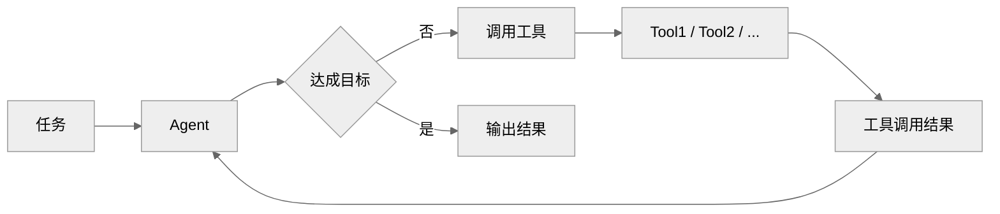
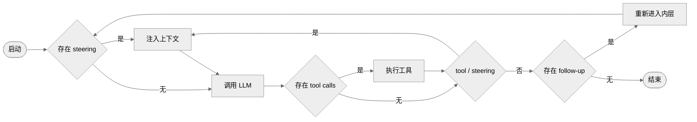
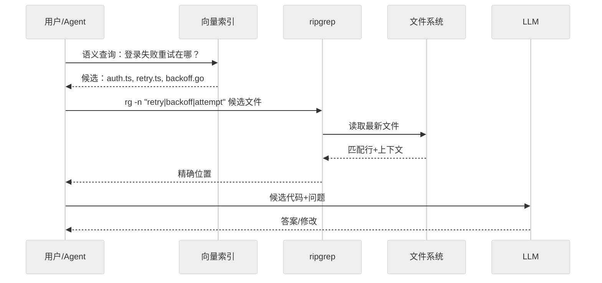
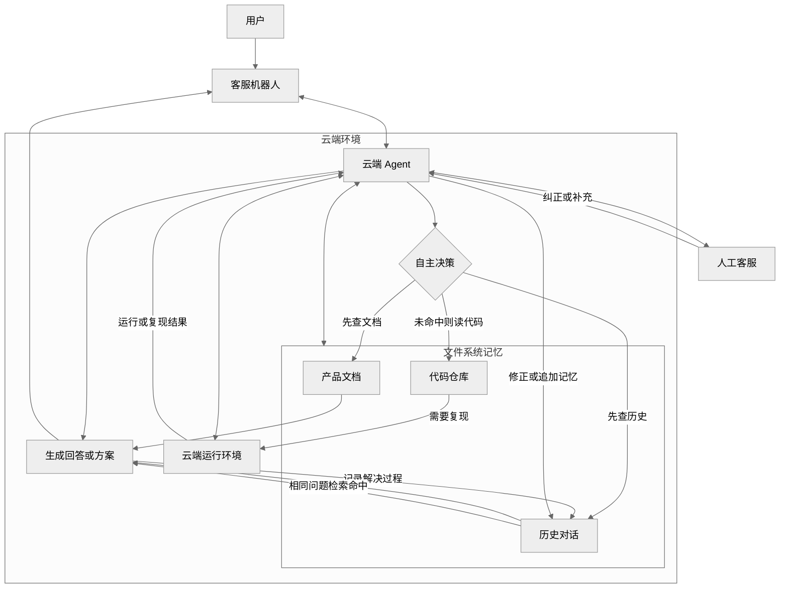
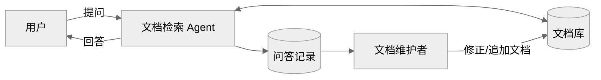

# 基于PI实现轻量级文档检索Agent
在先前我们讨论了基于向量检索实现基础`RAG`服务，在模型以及工程应用不断发展的情况下，文档检索模式也在演进，那么在这里就讨论一下如何基于`PI`实现轻量级文档检索`Agent`。

<details>
<summary><strong>LLM Engineering 系列相关文章</strong></summary>

- [基于 fetch 的 SSE 方案](./基于fetch的SSE方案.md)
- [基于向量检索实现基础 RAG 服务](./基于向量检索实现基础RAG服务.md)
- [流式 Markdown 增量富文本解析算法](./流式Markdown增量富文本解析算法.md)
- [基于 NodeJs 实现任务队列与优雅停机](./基于NodeJs实现任务队列与优雅停机.md)
- [仿照豆包实现 Prompt 变量模板输入框](./仿照豆包实现Prompt变量模板输入框.md)
- [基于 MdIt 的无序列表折叠插件](./基于MdIt的无序列表折叠插件.md)
- [基于 PI 实现轻量级文档检索 Agent](./基于PI实现轻量级文档检索Agent.md)

</details>

## 概述
截止目前，`AI`商业化过程中，`Coding`领域是比较流畅的商业模式，此外还有视频领域商业模式也发展的不错。而现在很多领域都是在将`AI Coding`的模式带到其他领域，例如当前正在主要发力的`AI`办公场景，在知识库场景也同样如此。

在讨论知识库的时候，首先想到的可能就是`RAG`。`RAG`最开始主要用于外挂知识库，以此扩展模型的知识范围。这个模式非常依赖于工程本身的建设，本质上相当于直接告诉`AI`答案，模型在这里主要起到的主要作用是`Embedding`、`Query`改写以及答案总结。

再往后发展，出现了记忆系统，即模拟短期记忆和长期记忆实现。但是在记忆系统中，同样依赖于工程本身的实现，读取和写入都是由记忆系统本身决定的，类似于工程替模型本身做了决策，而写记忆和读记忆的决策本身又是需要上下文，这存在一个循环依赖的问题。

其实，在当前的模型本身越来越强的情况下，我们可以总结检索的最佳实践为: **从“知识被动投放到模型”转变为“模型主动探索知识”**。

那么本文标题重点表达是文档检索的`Agent`实现，实际上这里的主要思路是，文档站对读者而言可能主要就是个文档集。而借助`Agent`使其自主检索用户所需的知识，类似于`DeepResearch`，那么文档站就变成了一个知识库。

因此在这里我们借助`PI`实现轻量级文档检索`Agent`，不过在当前`AI Coding`几乎接管了具体代码实现的状态下，这里主要还是简单讨论一些实现思路以及需要考虑的问题点，不再详细展开代码实现细节了。

## Loop Agent
前边提到，最开始的文档检索主要是`RAG`的模式，而得益于模型以及上下文工程的发展，通过`Loop`的方式，模型可以最终得到一个收敛的结果，而不必非得要通过预设`workflow`的方式得到目标结果。

所谓`Loop`，就是模型在执行任务的过程中，根据上下文和工具的反馈，不断调整自己的行为，直到最终得到一个收敛的结果。其实这也挺依赖于模型能力，否则也会出现无法收敛即无限循环的情况，通过这种方式实现的`Agent`，我们简称为`Loop Agent`。



接下来，可以直接借助`PI`来实现`Loop Agent`。在这里没有太大必要自己实现一套`Loop`机制，在`PI`中将核心包拆了出来，在这里主要使用的是`@earendil-works/pi-agent-core`核心包以及`@earendil-works/pi-ai`适配器。

在使用`PI`的`Loop`时，还是有必要读一下 <https://zhanghandong.github.io/pi-book/ch08-agent-loop.html> 。这里主要介绍了`PI`的两层循环，分别对应了`steer/followup`两种类型的消息任务模式。

- `Steering`转舵: 用户在`Agent`工作过程中插入一条新指令，希望立即更改模型运行方向。即在当前`turn`的工具执行完成后注入，影响下一次`LLM`调用。
- `Follow-up`追加: 用户在`Agent`完成后追加一条新任务，类似于当前任务完成之后增加了新的任务，在`Loop`中实现是只在`Agent`本来要退出时才被消费。



不过，这是相对比较标准的模式，实际上还有更简单的实现模式。例如在`trae work`中，实际发送消息是`Follow-up`类型的，但是用户可以手动`Hover`到消息上，选择立即发送。立即发送也并非`steering`类型，而是直接停止现有消息，然后通过新消息继续执行。

接下来，我们主要关注的就是为`Agent`提供的`Tools`即可。在这里可以有`MCP`和`SKILL`两种选择，但本质上都是一样的，都是交予模型相关索引，然后由模型自行决定调用哪个工具，之后根据工具的反馈，继续执行下一次`LLM`调用。

由于文档站可能提供了`MCP`接口，这就可以将文档站的检索功能作为`SKILL`来使用，或者直接将`MCP`接入`Agent`中。当前提供的工具主要为`search_docs`、`list_docs`、`fetch_doc`工具，分别对应了文档站的检索、列表和获取操作。

- `search_docs`: 检索文档，基于`Elasticsearch`全文搜索，返回标题、关键词、摘要与高亮片段。
- `list_docs`: 列出文档索引，返回目录、标题、文档`id`与摘要，支持关键词过滤与分页。
- `fetch_doc`: 根据文档`id`获取文档正文内容，支持分页读取。

```js
// https://github.com/earendil-works/pi/blob/ea448f4/packages/coding-agent/src/core/tools/ls.ts
// https://github.com/earendil-works/pi/blob/ea448f4/packages/coding-agent/src/core/skills.ts#L378
import { Agent, type AgentTool } from "@earendil-works/pi-agent-core";
import { Type } from "typebox";

const searchDocs: AgentTool = {
  name: "search_docs",
  label: "Search Docs",
  description: "检索文档，返回标题/摘要/高亮片段",
  parameters: Type.Object({ query: Type.String() }),
  execute: async () => { /* xxx */ },
};

const agent = new Agent({
  streamFn,
  initialState: {
    model,
    systemPrompt: basePrompt,
    tools: [searchDocs, listDocs, fetchDoc],
  },
});
```

虽然`Agent`层上仅使用了`core`包，`Tools`的工具调用也还是不需要我们自己组装的。`PI`中会自动将其组装出`tools`以及`function`字段，并且将相关描述、参数等组装过去，当然实际函数调用也不需要我们处理。

```js
// <-
{
  "messages": [
    { "role": "system", "content": "You are a docs search agent." },
    { "role": "user", "content": "帮我找任务队列的文档" }
  ],
  "tools": [{
    "type": "function",
    "function": {
      "name": "search_docs",
      "description": "检索文档，返回标题/摘要/高亮片段",
      "parameters": {
        "type": "object",
        "properties": { "query": { "type": "string" } },
        "required": ["query"]
      }
    }
  }]
}
// -> // OpenAI Chat Completions 风格
{
  "choices": [{
    "message": {
      "role": "assistant",
      "content": null,
      "tool_calls": [{
        "id": "call_abc123",
        "type": "function",
        "function": { "name": "search_docs", "arguments": "{\"query\":\"task queue\"}" }
      }]
    }
  }]
}
// <-
{
  "messages": [
    { "role": "system", "content": "You are a docs search agent." },
    { "role": "user", "content": "帮我找任务队列的文档" },
    { "role": "assistant", "tool_calls": [ /* call_abc123... */ ] },
    { "role": "tool", "tool_call_id": "call_abc123", "content": "search result ..." }
  ],
  "tools": [ /* ... */]
}
```

其实，在模型发展迅速的情况下，越重的工程反而更容易积重难返，例如最开始常见的`Workflow`调用模型的方式。就当前而言，可以说工程并不是越重越好，而由于`LLM`是纯语言的，缺乏环境感知能力，所以发力的核心目标应该围绕着增强环境感知能力。

说到这里，还有个问题是服务端用户粘性，在分布式环境的情况下，用户每次发送的消息都有可能会被路由到不同的节点。而虽然模型调用是无状态的，但是`PI`实例是有状态的，实现`steering`这种交互就需要命中同实例。

所以，这种情况下要么能够比较稳定命中同实例，要么就考虑直接使用`websocket`来实现。还有一种办法是，可以直接取消当前的对话，然后通过新消息继续执行，并且这个新的对话是新实例直接`new Agent`重新开始，这种方法在分布式环境下实现起来比较简单。

- 标记会话实例: 通过`Cookie`或者其他标记来保持命中实例。
- `TCP`长链接: `Websocket`本身就是长链接，天然支持保持会话。
- 会话重建: 当用户重新发起对话时，需要重新创建一个`Agent`实例，来保持会话的连续性。

还有个交互上的问题，当前比较主流的交互模式是，当发起任务之后除了最后的结果之外，其他的内容都会折叠起来。那么此时，交互模式上会没有那么流畅，模型通常会先输出一段文本作为引导，再执行`tool`调用，即先内容后`tool`的执行顺序。

问题就来了，在输出文本的时间内，是无法感知到后续是否存在`tool`，即不知道当前消息是否是最后一段消息。特别是在流式返回的情况下，是无法得知某消息是否为最终结果的，因此这个交互上就需要一个机制来控制。

- 先平铺后收起: 当模型输出结束后，再将所有调用过程折叠起来。只不过这样通常会发生一次`UI`跳变，交互模式上不会那么流畅。
- 任务结束总结: 定义任务总结`Tool`，将该问题交予模型判断。在`PI`中也可以在`tool`结果后加入`terminate: true`标记，支持主动跳出内层循环，可以避免后续再触发模型调用。
- 思考工具调用: 这是比较流畅的交互模式，思考本身起到了工具调用引导的作用。这样的话，就隔离了需要折叠的部分-思考/工具调用，不需要折叠的部分-最终结果，`think-tool-think-tool-answer`。值得注意的是，思考不必开的很高，以`medium`为优。

## 多级索引
对于模型来说，索引的作用非常重要，像是`SKILL`这套模式就是索引模式，或者称为渐进式披露。以此按需把内容加载进上下文，通常可以分成三级：

- `L1`声明: 常驻上下文，`SKILL.md`的`name+description`，作用类似路由/选择索引，决定是否该用`skill`。
- `L2`正文: 触发时加载，`SKILL.md`的指令内容、步骤与规则，技能被命中后才读入。
- `L3`资源: 按需加载，捆绑的脚本、`reference/*.md`、模板等，只在真正需要时读取，可只取其中部分文件。

换个角度想，`SKILL`本身其实也是文档，特别是在系统中存在大量`SKILL`的时候。而文档检索本质上也可以看作从知识库中，找到目标相关的文档内容，因此针对文档站本身实现索引，也是非常必要的。

因此实际`llms.txt`就可以认为是为文档站提供的索引，当然通常是主要提供了一级索引。如果文档站内容比较多的话，可以再考虑建立多级索引，最好是按照实体向下延伸，实现类似树形的结构。 对于单条记录，可以按照如下格式索引:

```text
- [目录1 / 目录2 / 文档标题](文档路径): 文档摘要
```

特别地，还有通过内容实现多级索引。也就是说，会将关键字、摘要、实体等概念实际放置于文档内容中，作为索引，然后再通过这些内容来索引下级目录文档，这种方式对于作为知识库的形式更合适一些。

```text
总索引
  ├─ 标签索引1
  │   ├─ 文档1
  │   └─ 文档2
  └─ 标签索引2
       └─ 目录/文档
```

其实在这里的`llms.txt`就是先前提到的`list_docs`工具，在工具中支持了`grep`和分页之后，实际测试的效果还是不错的。不过引入读索引工具来检索，虽然效果会好一些，但是同样的也会更消耗`token`。

## 检索模式
搜索本身也可以认为是一种索引，现在比较常见的就是`ElasticSearch`的关键词检索，以及`RAG`常用的向量检索。对于`ES`部分，可以提供比较通用的检索模式，搜索模式还是倒排索引，需要支持`IK Analysis`分词插件，以`must`匹配召回，`should`匹配加分。

```js
{
  "mappings": {
    "properties": {
      "id": { "type": "keyword" },
      "title": {
        "type": "text",
        "analyzer": "ik_max_word",
        "search_analyzer": "ik_smart",
      },
      // ...
    }
  }
}
```

```js
{
  "must": [
    {
      "multi_match": {
        "query": "Query Text",
        "fields": ["title^4",  "keywords^3", "summary^3", "content^1"],
        "type": "best_fields",
        "minimum_should_match": "1<1 3<30%"
      }
    }
  ],
  "should": [
    {
      "multi_match": {
        "query": "Query Text",
        "fields": ["title^4", "keywords^3", "summary^3", "content^1"],
        "type": "phrase",
        "boost": 2
      }
    }
  ]
}
```

向量检索部分基于嵌入向量和相似度计算，例如余弦相似度，擅长语义理解和模糊匹配，比较适合跟`ES`结合使用。不过向量检索本身有比较多的实现，主要是向量数据库，例如`Milvus`、`VikingDB`等，具体实现需要与本身数据库结合，可以参考之前的向量检索文章。

此外，代码检索会比较特殊，除了`Code Embedding`等一些方式外，像是`Claude Code`等工具，都是直接大力出奇迹。也就是我们常说的`grep`搜索，准确来说是`ripgrep`命令，有点类似于全文检索。

`rg`主要是文本级搜索，不依赖语法结构，但速度极快，其默认行为很适合搜代码。大力出奇迹的方式还是非常有效的，从实际表现上来看，文件系统是非常好用的上下文管理模式，直接`grep`效果已经得到广泛验证。



`Manus`将文件系统视为终极上下文: 大小不受限制，天然持久化，并且`Agent`可以直接操作。模型学会按需写入和读取文件——不仅将文件系统用作存储，还用作结构化的外部记忆。

偏个题，在内部客服场景下，用文件系统直接管理内部知识有个比较不错的实践。可以在云端启动一个`Agent`，并且对接一个机器人，然后其中将对话记录、产品文档、代码仓库等直接放置于云端，每个介入的对话都会直接记录下来，以文件系统作为记忆系统。

那么这个问答流程就是，让模型自主决策应该先检查文档或者历史对话消息，如果没有找到的话，可以读代码，甚至可以直接在云端环境下将代码跑起来复现问题。并且每次问题解决记录会被记录下来，下次相同的问题可以直接回答，回答错误也可以让`Agent`来修正存储的记忆。



## 正向反馈系统
在这里实现文档检索`Agent`，本身属于文档站的客服机器人，因此这里可以比较轻易地收集到用户的问题和回答。那么在这里，这个正向反馈系统就是，用户每次问题解决后，都可以通过人工客服来修正或追加文档内容。



其实从这里也能看出来，维护文档的作用越来越重，无论是什么角色，都需要将重点转移到文档上。前边也提到了，`SKILL`本身也是文档，再广泛点看，给模型提供的上下文都可以作为文档看待。

## 总结
在本文中，主要是基于`PI`实现了轻量级的文档检索`Agent`，把文档站从被检索的对象的`RAG`模式，变成了被`Agent`主动探索的知识库模式。将决策权完全交给了模型，工程上需要将感知环境的能力做好。

提个额外的话题，最开始的时候，大家在做云端`Agent`，典型的就是`workflow`的形式；后来发展趋势是做本地`Agent`，例如`Code`场景；再到后来本地`Agent`和云端`Agent`结合，根据场景可以在云端跑也可以在本地跑；未来的`Agent`发展方向还是很难预测的。


## 每日一题

- <https://github.com/WindRunnerMax/EveryDay>

## 参考

- <https://github.com/earendil-works/pi>
- <https://zhanghandong.github.io/pi-book/>
- <https://zhanghandong.github.io/pi-book/ch16-skills.html>
- <https://zhanghandong.github.io/pi-book/ch08-agent-loop.html>
- <https://zhanghandong.github.io/pi-book/ch15-extensions.html>
- <https://manus.im/zh-cn/blog/Context-Engineering-for-AI-Agents-Lessons-from-Building-Manus>
- <https://github.com/claude-code-best/claude-code/blob/79742411/docs/tools/search-and-navigation.mdx>
