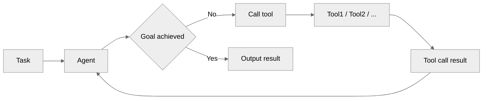
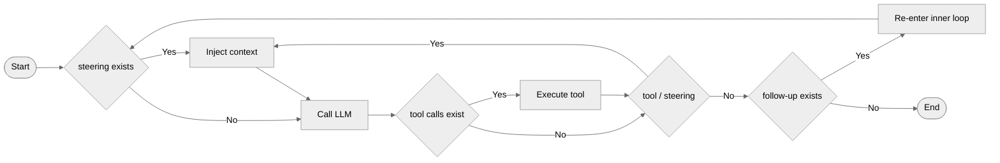
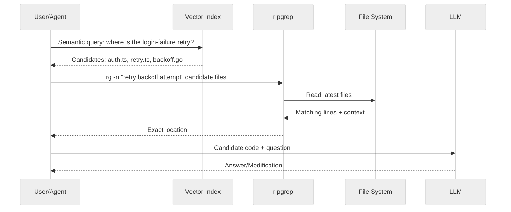
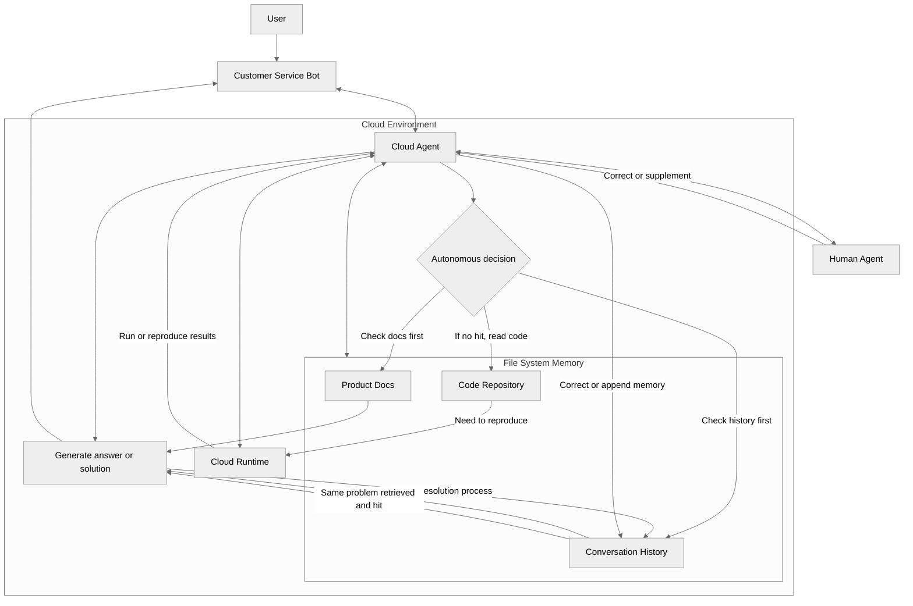
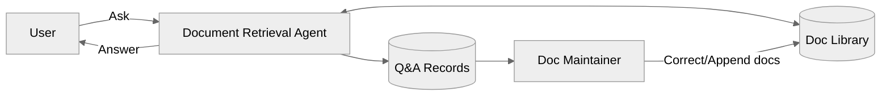

# Implementing a Lightweight Document Retrieval Agent Based on PI
Previously we discussed implementing a basic `RAG` service based on vector retrieval. As models and engineering applications continue to evolve, document retrieval patterns are also evolving. So here we discuss how to implement a lightweight document retrieval `Agent` based on `PI`.

<details>
<summary><strong>Related Articles from the LLM Engineering Series</strong></summary>

- [SSE Solution Based on Fetch](./基于fetch的SSE方案.md)
- [Implementing Basic RAG Service Based on Vector Retrieval](./基于向量检索实现基础RAG服务.md)
- [Incremental Rich Text Parsing Algorithm in Streaming Markdown](./流式Markdown增量富文本解析算法.md)
- [Implementing a Task Queue and Graceful Shutdown Based on NodeJs](./基于NodeJs实现任务队列与优雅停机.md)
- [Implementing Prompt Variable Template Input Box Like Bean Pack](./仿照豆包实现Prompt变量模板输入框.md)
- [Collapsible Unordered List Plugin Based on Markdown-it](./基于MdIt的无序列表折叠插件.md)
- [Implementing a Lightweight Document Retrieval Agent Based on PI](./基于PI实现轻量级文档检索Agent.md)

</details>

## Overview
To date, in the commercialization of `AI`, the `Coding` field is a relatively smooth business model, and the video field has also developed well. Many fields are now bringing the `AI Coding` model to other domains, such as the `AI` office scenario that is currently a major focus, and the knowledge base scenario is no different.

When discussing knowledge bases, the first thing that comes to mind is probably `RAG`. `RAG` was originally used mainly to attach an external knowledge base, thereby extending the model's knowledge scope. This pattern depends heavily on the engineering itself; in essence, it is equivalent to directly telling `AI` the answer, and the model's main roles here are `Embedding`, `Query` rewriting, and answer summarization.

Later, memory systems emerged—implementations that simulate short-term and long-term memory. But memory systems likewise depend on the engineering implementation: reads and writes are determined by the memory system itself, as if the engineering were making decisions on behalf of the model. Yet the decision of writing and reading memory itself requires context, which creates a circular dependency.

In fact, as current models become increasingly capable, we can summarize the best practice of retrieval as: **shifting from "passively feeding knowledge into the model" to "having the model actively explore knowledge"**.

The focus expressed by the title of this article is the `Agent` implementation of document retrieval. Actually, the main idea here is that, to readers, a documentation site is probably just a document collection. With the help of an `Agent` that autonomously retrieves the knowledge the user needs—similar to `DeepResearch`—the documentation site becomes a knowledge base.

So here we use `PI` to implement a lightweight document retrieval `Agent`. However, in the current state where `AI Coding` has almost taken over the concrete code implementation, we mainly discuss some implementation ideas and problems to consider, without elaborating on code implementation details.

As an additional note: at first, everyone built cloud `Agent`s, typically in the form of `workflow`; later the trend became building local `Agent`s, such as in the `Code` scenario; and later still, local and cloud `Agent`s were combined, so depending on the scenario they can run in the cloud or locally; what form `Agent`s will take in the future is still very hard to predict.

## Loop Agent
As mentioned earlier, document retrieval originally mainly used the `RAG` pattern. Thanks to the development of models and context engineering, through the `Loop` approach the model can eventually arrive at a converged result, without necessarily having to produce the target result through a preset `workflow`.

The so-called `Loop` means that while executing a task, the model continuously adjusts its behavior based on the context and tool feedback until it eventually reaches a converged result. This also depends considerably on model capability; otherwise there can be a failure to converge, i.e., an infinite loop. An `Agent` implemented this way we call a `Loop Agent` for short.



Next, we can implement the `Loop Agent` directly with `PI`. There is little need to implement a `Loop` mechanism ourselves; `PI` has split out its core packages, and here we mainly use the `@earendil-works/pi-agent-core` core package and the `@earendil-works/pi-ai` adapter.

When using `PI`'s `Loop`, it is still worth reading <https://zhanghandong.github.io/pi-book/ch08-agent-loop.html>. It mainly introduces `PI`'s two-layer loop, corresponding to the two types of message task modes, `steer/followup`.

- `Steering`: the user inserts a new instruction while the `Agent` is working, hoping to immediately change the model's direction. That is, it is injected after the current `turn`'s tool execution completes, affecting the next `LLM` call.
- `Follow-up`: the user appends a new task after the `Agent` completes, similar to adding a new task after the current one is done. In the `Loop` implementation, it is consumed only when the `Agent` is about to exit.



However, this is a relatively standard pattern; there are actually simpler implementations. For example, in `trae work`, messages are actually sent as the `Follow-up` type, but users can manually `Hover` over a message and choose to send immediately. Sending immediately is also not of the `steering` type; instead, it directly stops the existing message and then continues execution with a new message.

Next, what we mainly focus on is the `Tools` provided to the `Agent`. Here there are two options, `MCP` and `SKILL`, but they are essentially the same: both hand the relevant index to the model, and the model decides on its own which tool to call, then continues with the next `LLM` call based on the tool's feedback.

Since a documentation site may provide an `MCP` interface, its retrieval functionality can be used as a `SKILL`, or the `MCP` can be plugged directly into the `Agent`. The tools currently provided are mainly `search_docs`, `list_docs`, and `fetch_doc`, corresponding to the documentation site's search, list, and fetch operations.

- `search_docs`: searches documents, based on `Elasticsearch` full-text search, returning titles, keywords, summaries, and highlights.
- `list_docs`: lists the document index, returning the catalog, titles, document `id`s, and summaries, supporting keyword filtering `grep` and pagination.
- `fetch_doc`: fetches the document body content by document `id`, supporting paginated reading.

```js
// https://github.com/earendil-works/pi/blob/ea448f4/packages/coding-agent/src/core/tools/ls.ts
// https://github.com/earendil-works/pi/blob/ea448f4/packages/coding-agent/src/core/skills.ts#L378
import { Agent, type AgentTool } from "@earendil-works/pi-agent-core";
import { Type } from "typebox";

const searchDocs: AgentTool = {
  name: "search_docs",
  label: "Search Docs",
  description: "Search documents, returning title/summary/highlight snippets",
  parameters: Type.Object({ query: Type.String() }),
  execute: async () => { /* xxx */ },
};

const agent = new Agent({
  streamFn,
  initialState: {
    model,
    systemPrompt: basePrompt,
    tools: [searchDocs, listDocs, fetchDoc],
  },
});
```

Although the `Agent` layer uses only the `core` package, we still don't need to assemble the `Tools` tool calls ourselves. `PI` automatically assembles the `tools` and `function` fields, and maps the relevant descriptions, parameters, etc. over; of course, the actual function invocation is not something we need to handle either.

```js
// <-
{
  "messages": [
    { "role": "system", "content": "You are a docs search agent." },
    { "role": "user", "content": "Help me find the documentation on task queues" }
  ],
  "tools": [{
    "type": "function",
    "function": {
      "name": "search_docs",
      "description": "Search documents, returning title/summary/highlight snippets",
      "parameters": {
        "type": "object",
        "properties": { "query": { "type": "string" } },
        "required": ["query"]
      }
    }
  }]
}
// -> // OpenAI Chat Completions style
{
  "choices": [{
    "message": {
      "role": "assistant",
      "content": null,
      "tool_calls": [{
        "id": "call_abc123",
        "type": "function",
        "function": { "name": "search_docs", "arguments": "{\"query\":\"task queue\"}" }
      }]
    }
  }]
}
// <-
{
  "messages": [
    { "role": "system", "content": "You are a docs search agent." },
    { "role": "user", "content": "Help me find the documentation on task queues" },
    { "role": "assistant", "tool_calls": [ /* call_abc123... */ ] },
    { "role": "tool", "tool_call_id": "call_abc123", "content": "search result ..." }
  ],
  "tools": [ /* ... */]
}
```

In fact, given how fast models are developing, the heavier the engineering, the more prone it is to accumulated debt—such as the initially common approach of calling models with `Workflow`. As things stand now, engineering is not "the heavier the better"; and since `LLM`s are purely linguistic and lack environmental perception, the core goal we should focus our efforts on is enhancing environmental perception.

Speaking of which, there is another issue: server-side user stickiness. In a distributed environment, each message a user sends may be routed to a different node. And while model invocation is stateless, a `PI` instance is stateful, so implementing an interaction like `steering` requires hitting the same instance.

So in this case, either the same instance must be hit fairly reliably, or you should consider using `websocket` directly. Another approach is to directly cancel the current conversation and then continue execution with a new message, where the new conversation is a brand-new instance created directly via `new Agent`, starting over; this approach is simpler to implement in a distributed environment.

- Tagging the session instance: maintain instance affinity via a `Cookie` or other marker.
- `TCP` long connection: `Websocket` is itself a long connection, naturally supporting session persistence.
- Session rebuild: when the user initiates a new conversation, a new `Agent` instance needs to be created to maintain session continuity.

There is also an interaction issue. The currently mainstream interaction pattern is that after a task is initiated, everything except the final result is collapsed. At that point the interaction is less smooth; the model usually first outputs a piece of text as a lead-in, then executes the `tool` call, i.e., text first, `tool` second.

Then the problem arises: during the time the text is being output, there is no way to know whether a `tool` will follow, i.e., you don't know whether the current message is the last one. Especially in the case of streaming responses, you cannot know whether a message is the final result, so a mechanism is needed to control this interaction.

- Flatten then collapse: collapse all the call process after the model finishes outputting. However, this usually causes a `UI` jump, making the interaction less smooth.
- Task-end summarization: define a task-summarization `Tool` and leave this question to the model to judge. In `PI`, you can also add a `terminate: true` marker after the `tool` result, which supports actively breaking out of the inner loop and avoids triggering subsequent model calls.
- Thinking tool call: this is a relatively smooth interaction pattern, where thinking itself serves to guide the tool call. In this way, the parts that need collapsing—thinking/tool calls—are isolated from the parts that don't—the final result: `think-tool-think-tool-answer`. Notably, thinking does not need to be set very high; `medium` is preferable.

## Index and Search
For a model, the role of the index is very important. A pattern like `SKILL` is an indexing pattern, or what is called progressive disclosure. In this way, content is loaded into context on demand, and it can usually be divided into three levels:

- `L1` declaration: resident in context, the `name+description` of `SKILL.md`, functioning like a routing/selection index that determines whether the `skill` should be used.
- `L2` body: loaded when triggered, the instruction content, steps, and rules of `SKILL.md`, read in only after the skill is hit.
- `L3` resources: loaded on demand, bundled scripts, `reference/*.md`, templates, etc., read only when actually needed, and only some of the files may be taken.

Looking at it from another angle, `SKILL` itself is actually also documentation, especially when there are a large number of `SKILL`s in a system. And document retrieval can essentially be seen as finding the content of documents relevant to the target from a knowledge base, so implementing an index for the documentation site itself is also very necessary.

Therefore, in practice `llms.txt` can be regarded as the index provided for a documentation site, though it usually mainly provides a first-level index. If the documentation site has a lot of content, you can consider building a multi-level index, preferably extending downward by entity to form a tree-like structure. For a single record, it can be indexed as follows:

```text
- [Category1 / Category2 / Document Title](document path): document summary
```

In particular, there is also multi-level indexing through content. That is, concepts such as keywords, summaries, and entities are actually placed in the document content as an index, and then these contents are used to index the documents in lower-level directories. This approach is more suitable for the form of a knowledge base.

```text
Master index
  ├─ Tag index 1
  │   ├─ Document 1
  │   └─ Document 2
  └─ Tag index 2
       └─ Category/Document
```

In fact, the `llms.txt` here is the `list_docs` tool mentioned earlier; after `grep` and pagination are supported in the tool, the actual test results were pretty good. However, introducing an index-reading tool for retrieval, while giving somewhat better results, also consumes more `token`s.

Search itself can also be regarded as a kind of index. The more common ones now are `ElasticSearch` keyword search and the vector search commonly used in `RAG`. For the `ES` part, a fairly general retrieval pattern can be provided; the search pattern is still the inverted index, requiring support for the `IK Analysis` tokenizer plugin, using `must` for recall matching and `should` for scoring.

```js
{
  "mappings": {
    "properties": {
      "id": { "type": "keyword" },
      "title": {
        "type": "text",
        "analyzer": "ik_max_word",
        "search_analyzer": "ik_smart",
      },
      // ...
    }
  }
}
```

```js
{
  "must": [
    {
      "multi_match": {
        "query": "Query Text",
        "fields": ["title^4",  "keywords^3", "summary^3", "content^1"],
        "type": "best_fields",
        "minimum_should_match": "1<1 3<30%"
      }
    }
  ],
  "should": [
    {
      "multi_match": {
        "query": "Query Text",
        "fields": ["title^4", "keywords^3", "summary^3", "content^1"],
        "type": "phrase",
        "boost": 2
      }
    }
  ]
}
```

The vector retrieval part is based on embedding vectors and similarity computation, such as cosine similarity; it excels at semantic understanding and fuzzy matching, and is more suitable for use in combination with `ES`. However, vector retrieval has many implementations of its own, mainly vector databases such as `Milvus`, `VikingDB`, etc.; the specific implementation needs to be combined with the database itself, and you can refer to the previous article on vector retrieval.

In addition, code retrieval is rather special. Besides methods such as `Code Embedding`, tools like `Claude Code` all just brute-force it. That is, the `grep` search we often talk about—more precisely, the `ripgrep` command, which is somewhat similar to full-text search.

`rg` is mainly text-level search; it does not depend on syntax structure but is extremely fast, and its default behavior is well suited to searching code. The brute-force approach is still very effective; from actual results, the file system is a very useful context management pattern, and direct `grep` has already been widely validated.



`Manus` treats the file system as the ultimate context: unlimited in size, naturally persistent, and directly operable by the `Agent`. The model learns to write and read files on demand—using the file system not only as storage but also as structured external memory.

As a digression, in the internal customer service scenario, there is a pretty good practice of directly managing internal knowledge with the file system. You can launch an `Agent` in the cloud and connect it to a bot, then place conversation records, product documentation, code repositories, etc. directly in the cloud; every intervening conversation is directly recorded, using the file system as the memory system.

Then the Q&A flow is: let the model autonomously decide whether to first check the documentation or historical conversation messages; if not found, it can read the code, or even directly run the code in the cloud environment to reproduce the problem. And each problem-resolution record is recorded, so the same problem next time can be answered directly, and if the answer was wrong, the `Agent` can correct the stored memory.



## Positive Feedback System
The document retrieval `Agent` implemented here is itself the customer service bot of the documentation site, so it can quite easily collect the user's questions and answers. Here, this positive feedback system means that after each user problem is resolved, the documentation content can be corrected or supplemented through the human agent.



From this we can also see that the role of maintaining documentation is becoming increasingly important. Regardless of the role, the focus needs to shift toward documentation. As mentioned earlier, `SKILL` itself is also documentation, and more broadly, all context provided to the model can be regarded as documentation.

## Conclusion
In this article, we mainly implemented a lightweight document retrieval `Agent` based on `PI`, turning the documentation site from the `RAG` pattern of being a retrieved object into a knowledge base actively explored by the `Agent`. Decision-making authority is entirely handed to the model, and on the engineering side, the ability to perceive the environment needs to be done well.

## Question of the Day

- <https://github.com/WindRunnerMax/EveryDay>

## References

- <https://github.com/earendil-works/pi>
- <https://zhanghandong.github.io/pi-book/>
- <https://zhanghandong.github.io/pi-book/ch16-skills.html>
- <https://zhanghandong.github.io/pi-book/ch08-agent-loop.html>
- <https://zhanghandong.github.io/pi-book/ch15-extensions.html>
- <https://manus.im/zh-cn/blog/Context-Engineering-for-AI-Agents-Lessons-from-Building-Manus>
- <https://github.com/claude-code-best/claude-code/blob/79742411/docs/tools/search-and-navigation.mdx>
